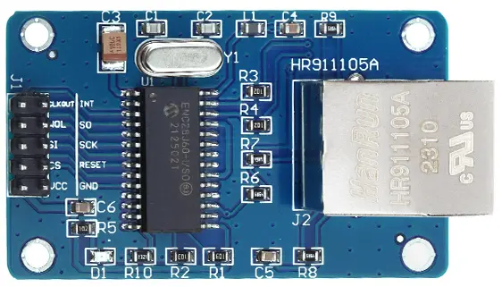
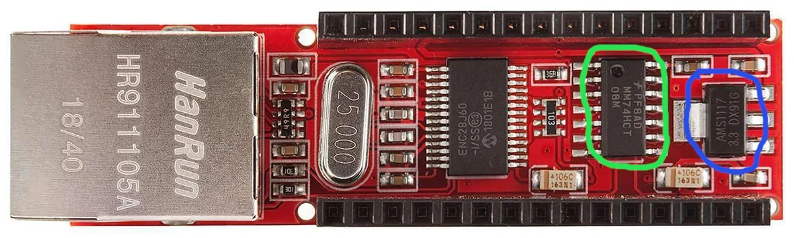
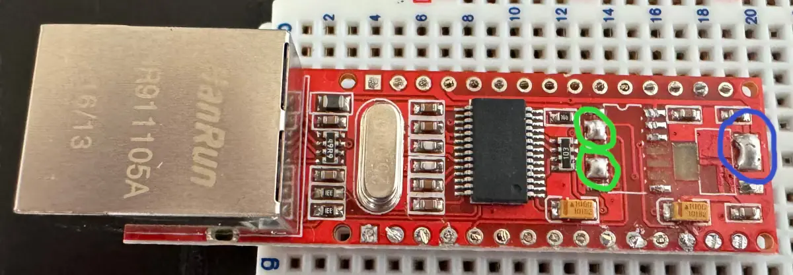

# PicoENC28J60

[](https://github.com/angeloINTJ/pico-enc28j60/actions/workflows/ci.yml)

Ethernet for the Raspberry Pi Pico in the Arduino IDE, with an ENC28J60 module. The
library has two layers, and you use the one you need:

 * `PicoENC28J60` (`PicoENC28J60.h`) sends and receives whole Ethernet frames and
   leaves the protocols to you.
 * `PicoENC28J60lwIP` (`PicoENC28J60lwIP.h`) is the same driver as a network
   interface of the lwIP stack in the
   [arduino-pico](https://github.com/earlephilhower/arduino-pico) core: DHCP, TCP and
   UDP sockets, `WiFiClient`, `WiFiServer`, `WebServer` and everything else that is
   built on lwIP.

It is a fork of [pico-enc28j60](https://github.com/ljanyst/pico-enc28j60) by Lukasz
Janyst, whose PIO program for SPI and ENC28J60 driver in C it is built on; see
[Credits and license](#credits-and-license).

## Features

 * **SPI on any free pins.** The link to the chip is a PIO program, so the hardware SPI
   blocks stay free. It claims one PIO state machine and leaves the others to
   `SerialPIO`, `Servo`, `tone` and the like.
 * **The INT pin is optional.** Wired, a frame is served the moment it arrives and an
   idle network costs no SPI traffic. Not wired, the chip is polled, and sooner right
   after a frame went out or came in.
 * **It does not hang.** `begin()` returns `false` when it cannot start and
   `lastError()` says why: a pin that is out of range or used twice, a state machine
   that is taken, no PIO with room, no chip answering. A PIO that stops running in the
   middle of a transfer, a chip that is reset by a glitch of its supply and a cable
   that is unplugged and plugged back are noticed and dealt with.
 * **The silicon errata that matter** (issues 6, 12, 13 and 14 of the
   [errata sheet](#references)) are worked around.
 * **Checked on real hardware** by a test bench that is part of the repository, and
   compiled by the CI for the Pico, Pico W, Pico 2 and Pico 2 W with the oldest and
   the newest supported cores. See [Testing](#testing).

## Hardware

The ENC28J60 is a 3.3 V chip, and there are many breakout boards for it that can be
used directly with a Pico.



### Wiring

The defaults of `ENC28J60Config`. Every pin can be changed.

| ENC28J60 board | Pico      | `ENC28J60Config` | Notes |
|----------------|-----------|------------------|-------|
| SCK            | GP2       | `sclk_pin`       | |
| SI (MOSI)      | GP3       | `mosi_pin`       | |
| SO (MISO)      | GP4       | `miso_pin`       | |
| CS             | GP5       | `cs_pin`         | any GPIO; it does not have to be next to SCK |
| RST            | GP7       | `rst_pin`        | optional; with -1 the chip is reset over SPI only |
| INT            | not wired | `irq_pin`        | optional; the GPIO wired to INT, -1 for none |
| VCC            | 3V3(OUT)  |                  | the chip is a 3.3 V one |
| GND            | GND       |                  | |

The library takes one state machine of one PIO block, 17 instructions of its program
memory (the program is loaded once per block and shared), and no DMA channel. The
hardware SPI is not used, because the commands of the chip are of variable length.

<details>
<summary>The Arduino Nano shield, which needs a modification</summary>

There's also an Arduino Nano shield with an ENC28J60, designed for a 5 V operation.
Coincidentally, that's the board that has been used for the development of the
original driver, but it needs to be modified before it can be used with a Pico.



The AMS1117 voltage regulator (marked blue) used to drop the supply voltage to 3.3 V
needs to be removed, as we are going to use the Pico's 3.3 V output to supply the
device directly. The MM74HCT08M AND gate (marked green) used as a buffer to raise the
voltage of the MOSI and interrupt signals to 5 V needs to be removed as well because
a Pico can't tolerate a GPIO input voltage this high. The connectors for the Vin and
Vout pins of the voltage regulator need to be shorted (marked blue on the picture
below) and so do the inputs and outputs of the AND gates responsible for the MOSI and
IRQ signals (marked green).



The relevant pins on this board are:

 * 5V - where we connect the Pico's 3.3 V output
 * GND - for ground, all of them are connected and will work fine
 * D13 - SPI clock
 * D12 - MISO
 * D11 - MOSI
 * D10 - Slave Select
 * D2 - Interrupt

</details>

## Installation

Install it from this repository; the Arduino Library Manager does not list it yet:

 * Arduino IDE: download `PicoENC28J60-<version>.zip` from the
   [latest release](https://github.com/angeloINTJ/pico-enc28j60/releases/latest),
   then *Sketch > Include Library > Add .ZIP Library*.
 * From a clone, which makes it easy to stay up to date: clone the repository into
   your Arduino libraries folder (usually `~/Arduino/libraries`).
 * PlatformIO with the arduino-pico core:
   `lib_deps = https://github.com/angeloINTJ/pico-enc28j60.git#v1.1.0`

What changed in each version is in [CHANGELOG.md](CHANGELOG.md).

Requirements: the [arduino-pico](https://github.com/earlephilhower/arduino-pico) core,
4.0.0 or newer for `PicoENC28J60.h` (built with 4.0.0, 5.0.0 and 6.x) and 5.6.0 or
newer for `PicoENC28J60lwIP.h` (built with 5.6.0 and 6.x). The Arduino Mbed OS RP2040
boards are not supported. Everything was run on 6.3.0.

## Quick start

### A web page that toggles the LED

`examples/WebServerLedToggle` gets an address from DHCP and serves a page with a
*Toggle LED* button. The network part is just:

```cpp
#include <PicoENC28J60lwIP.h>

PicoENC28J60lwIP eth;  // default pins: SCK=GP2 MOSI=GP3 MISO=GP4 CS=GP5 RST=GP7

void setup() {
    eth.begin();                        // DHCP
    while (!eth.connected()) delay(100);
    // from here on use WiFiClient, WiFiServer, WebServer... as on any interface
}
```

### Raw frames

```cpp
#include <PicoENC28J60.h>

PicoENC28J60 eth;  // default pins

void setup() {
    Serial.begin(115200);
    if (!eth.begin()) {
        // say why: wrong pins, no free PIO state machine, no chip answering...
        Serial.println(PicoENC28J60::errorString(eth.lastError()));
        while (true) delay(1000);
    }
    Serial.printf("revision 0x%02X\n", eth.getRevision());
}

void loop() {
    uint8_t frame[PicoENC28J60::MAX_FRAME_SIZE];
    while (eth.available()) {
        uint16_t len = eth.receiveFrame(frame, sizeof(frame));  // length without the FCS
        if (len) Serial.printf("received %u bytes\n", len);
    }
}
```

Other pins or MAC address: fill in an `ENC28J60Config` and pass it to
`eth.begin(config)`. By default the library picks any PIO block with room for its
program and a free state machine; `pio_instance` and `pio_sm` choose them yourself.

## Using the INT pin

Wire the chip's INT pin to a free GPIO and give its number as `irq_pin`. The chip
pulls the line low when a frame arrives, the link changes or its receive buffer
overflows. `loop()` then asks `interruptPending()`, which only looks at that line and
costs no SPI traffic, and talks to the chip when the answer is yes:

```cpp
ENC28J60Config config;
config.irq_pin = 6;                       // INT on GP6
PicoENC28J60 eth(config);                 // eth.begin() in setup()

void loop() {
    if (eth.interruptPending()) {
        uint8_t flags = eth.getInterruptFlags();      // also masks the INT pin
        while (eth.available()) { /* eth.receiveFrame(...) */ }
        if (flags & PicoENC28J60::INT_LINK_CHANGE) { /* eth.linkStatus() */ }
        eth.acknowledgeInterrupts(flags);             // clears them, unmasks the pin
    }
}
```

The same loop works without the wire (`irq_pin` left at -1): `interruptPending()` then
reads the chip's flags instead, and reports a change of the link as well. Acknowledge the
flags you get, with or without the wire: a flag that stays set keeps `interruptPending()`
true. The library sets the pin up with the internal pull-up
and attaches the interrupt through the Arduino core, so your own `attachInterrupt()`
calls keep working.

An interrupt handler registered with `setInterruptCallback()` runs in interrupt
context and must not call this class: the chip is reached over one PIO state machine,
and a transfer started from the handler in the middle of one of the main program
corrupts both. Set a flag there and use `interruptPending()` in `loop()`. See
`examples/AdvancedTest`. With `PicoENC28J60lwIP` the same `irq_pin` makes the network
stack serve a frame the moment it arrives, see below.

## API reference

### ENC28J60Config

| Field | Default | Meaning |
|-------|---------|---------|
| `sclk_pin`, `mosi_pin`, `miso_pin` | 2, 3, 4 | the SPI pins |
| `cs_pin` | 5 | chip select, any GPIO |
| `rst_pin` | 7 | reset of the chip; -1 for none |
| `irq_pin` | -1 | the GPIO wired to INT; -1 when it is not wired |
| `spi_hz` | 10000000 | the SPI clock in Hz, from 100 kHz to 20 MHz, the limit of the chip. The errata ask for 8 MHz or more with the silicon revisions B1 and B4, and the default leaves room above it for the rounding of the divider of the PIO; going faster depends on the wiring. The PIO runs at four times this, so the system clock has to allow it |
| `mac_addr` | all zeros | the MAC address. Left at zeros, `begin()` makes a locally administered one from the unique ID of the board, so that two boards never share it; `getMACAddress()` says which |
| `rx_buffer_size` | `0x1000` | bytes of the 8 KB of the chip used for reception, the rest is the transmit area. Rounded down to an even number and kept between `0x0600` and `0x1A00`, so that both hold a full frame |
| `pio_instance`, `pio_sm` | -1, -1 | the PIO block (0, 1, ...) and the state machine (0-3) to claim; -1 lets the driver take any that is free |

### PicoENC28J60

 * `PicoENC28J60(const ENC28J60Config& config = ENC28J60Config())`
 * `bool begin()`, `bool begin(const ENC28J60Config&)` - initialize. Returns `false`
   when it cannot, and can be called again; `lastError()` says why (an `Error` value)
   and `PicoENC28J60::errorString(error)` turns it into text: a pin that is out of
   range or used twice, a buffer or an SPI clock that is out of range, a state
   machine that is taken, no PIO with room for the program, no chip answering, no
   memory.
 * `void end()` - stops the chip and gives back the state machine, the four SPI pins
   and the memory; `begin()` starts it again. The destructor calls it. The reset line
   is left high and the INT pin keeps its pull-up.
 * `bool linkStatus()` - the link takes a second or two to come up after `begin()`.
 * `uint8_t getRevision()`
 * `void getMACAddress(uint8_t* mac) const`, `void setMACAddress(const uint8_t* mac)`
 * `bool sendFrame(const uint8_t* frame, uint16_t len)` - blocking, up to
   `MAX_FRAME_SIZE` (1514) bytes, without the FCS.
 * `uint8_t available()` - frames waiting in the receive buffer.
 * `uint16_t receiveFrame(uint8_t* buffer, uint16_t max_len)` - length without the
   FCS, 0 if there is none. `void discardFrame()` drops the next frame.
 * INT pin (`irq_pin`): `interruptPending()` (the pin, no SPI traffic),
   `getInterruptFlags()` (reads the flags and masks the pin),
   `acknowledgeInterrupts(flags)` (clears them and unmasks the pin),
   `interruptCount()`. Looking without touching the pin: `peekInterruptFlags()`,
   `hasPacket()`, `hasLinkChange()`, `hasRXError()` (`hasTXComplete()` is deprecated:
   `sendFrame()` already waits for the frame to leave the wire).
   `setInterruptCallback()` and `poll()` are for a handler that only sets a flag.
   `hasPacket()` and `INT_PACKET_RX` come from the packet counter of the chip, because
   its packet flag is not reliable (silicon errata, issue 6).
 * `bool checkChip()` - one SPI transaction that tells whether the chip still holds its
   configuration; if it was reset, it is configured again. Once a second is plenty.
 * `const Stats& stats()` - frame counters, for diagnostics: `rx_frames`,
   `rx_dropped`, `rx_resets`, `tx_frames`, `tx_failures`, `tx_aborts` (the MAC gave
   up), `tx_retries` (a late collision was retried), `io_errors`, `recoveries` and
   `chip_resets` (see [Robustness](#robustness-and-limitations)).
 * `void* getDriverHandle()` - the handle of the C driver, for code that wants to call
   its [C API](docs/c-driver.md) directly.

### PicoENC28J60lwIP

Same API as the other wired Ethernet interfaces of the core (`begin()`, `config()`,
`connected()`, `localIP()`, `linkStatus()`, ...), plus `end()`, `lastError()`,
`setPollPeriod(ms)` and `driverStats()`. `begin()` returns `false` when no chip answers;
without a MAC address of your own, the core makes a locally administered one from the
board. Do not call the raw driver methods while it runs. Tested on a Pico (RP2040)
only. When the cable is unplugged and plugged back, lwIP is told and asks the DHCP
server again.

Every frame is handed to lwIP in buffers from its pool. The receive loop of the core
puts each one in a block of the heap of lwIP, which has 16 KB in the core, and a few
segments waiting there, out of order in a TCP connection or unread by the application,
left no block of 1514 bytes for the segment that was missing: it was dropped every time
it was sent again, and the connection stalled for as long as the timeouts of the peer
took. The FreeRTOS builds of the core do not run the polling worker of the library, and
keep that receive loop.

Give it a config with `irq_pin` set and it is driven by the INT line: the interrupt
handler only wakes the lwIP context up, which then reads the frames, so the chip is
never touched from interrupt context. On the bench that took the median time of a
`GET /` from 16 ms to 11 ms and made an idle network free of SPI traffic. The timer of
`setPollPeriod()` remains as a safety net (20 ms then).

Without the INT pin the chip is polled: every 5 ms while the line is quiet, and every
millisecond right after a frame went out or came in, backing off to 5 ms again when
nothing arrives. The peer's answer to a frame is usually on its way, and a fixed period
made the time of a request depend on where the timer happened to fall (13 ms or 18 ms
for the same page on the bench); with the adaptive period it is 10 to 11 ms.

## Robustness and limitations

What the library does when things go wrong:

 * **A PIO that does not run.** Another piece of code taking the state machine, or
   stopping it, would leave a blocking SPI transfer waiting forever. Transfers give up
   after about 8 ms without progress and read zeros; the class counts it
   (`stats().io_errors`), restarts the state machine and the chip, and counts that too
   (`stats().recoveries`), trying again every second while the chip does not answer.
   Frames in the chip's buffers are lost in the process.
 * **A chip that was reset**, by a glitch of its supply say, is back at its default
   registers with the receiver off, and nothing else would tell. `checkChip()` finds
   out and configures it again (`stats().chip_resets`); `PicoENC28J60lwIP` calls it
   once a second.
 * **A frame the MAC gives up on** after a late collision, which some link partners
   provoke in half duplex (silicon errata, issue 13), is sent again, up to 15 times
   (`stats().tx_retries`). Any other abort is final and `sendFrame()` returns `false`
   (`stats().tx_aborts`).
 * **A receive buffer that overflows** loses frames; `INT_RX_ERROR` tells you.

What it does not do:

 * It is 10 Mbit/s and **half duplex** only, as the chip is. The link partner has to
   detect that by itself, which every switch and router does.
 * SPI runs at 3.5 MHz, so a full-size frame takes about 3.5 ms to move between the
   chip and the Pico, and the throughput is well below the 10 Mbit/s of the wire. The
   clock is worked out from the system clock when `begin()` runs (and again when the
   chip is started over), so change the system clock before `begin()`, not after.
 * The receive filter is fixed: a frame is delivered if its CRC is good and it is
   addressed to the board, to everybody (broadcast) or to a group (multicast). There
   is no promiscuous mode, and frames with a bad CRC never get to you.
 * `sendFrame()` and the receiving functions block while they talk to the chip; they
   are not meant to be called from interrupt handlers.
 * **Tested on** a Raspberry Pi Pico (RP2040) with an ENC28J60 revision B7 and the
   arduino-pico core 6.3.0. The sketches also compile for the Pico W, Pico 2 and
   Pico 2 W, but have not been run on them. The FreeRTOS+TCP driver is the one of the
   original project, and was not built or run here.
 * The receive buffer of the chip is small (4 KB, 6.5 KB at most with
   `rx_buffer_size = 0x1A00`; the transmit side only needs one frame) and reading a
   frame from it takes 3.5 ms, while one can arrive every 1.2 ms. A peer that sends a
   window of data at once, like several bulk TCP transfers at the same time, overflows
   it, and TCP recovers slowly: one connection echoes 200 kB at about 50 kB/s on the
   bench, and requests and answers are fine.

## Examples

See the `examples/` folder:

 * `WebServerLedToggle` - a web page with a Toggle LED button (lwIP, DHCP). Checked
   with a real browser on the bench.
 * `BasicTest` - raw frames: initialization, link, receive and print, send a test
   frame (a broadcast with the experimental EtherType 0x88B5, never an ARP or ICMP
   that could confuse a real network).
 * `AdvancedTest` - interrupt mode (needs INT wired to GP6), custom MAC, frame
   parsing. Checked on the bench.

## Testing

Every push is built by the [CI](.github/workflows/ci.yml): `arduino-lint`,
`clang-format`, a check that the PIO header matches its source, every sketch for four
boards (the three that can use the INT pin also built with it), the oldest and the
newest supported cores, and the C driver as a CMake library with the Pico SDK, with
`-Werror` and, on the driver files, the static analyzer of GCC and `-Wconversion`.

The CI cannot test a network, so `extras/bench` has tests that run against a real
board and your LAN, driven by Python scripts on the PC:

| Script | Sketch | What it checks |
|--------|--------|----------------|
| `bench.py` | `BenchTest` | the raw class: ping, receive and echo streams, transmit streams, a long soak, a receiver overload, configuration errors, a PIO that does not run, a chip that is reset, and the INT pin |
| `benchlwip.py` | `BenchLwip` | the lwIP interface: DHCP, ping both ways, TCP and UDP servers and clients, bulk transfers through several connections, a cable that is pulled out, a chip that is reset, a static address, repeated `end()` and `begin()` |
| `webtest.py` | `WebServerLedToggle` | the web example: sequential and parallel requests, 100 toggles, a soak |

```
python3 extras/bench/bench.py --ip 192.168.3.77 --flash --irq 6
```

`extras/bench/README.md` lists every test, what you need and how to run them.

## The C driver and FreeRTOS

The Arduino classes are built on the driver in C of the original project, which also
works on its own in a Raspberry Pi Pico SDK project, and has a network interface for
FreeRTOS+TCP. [docs/c-driver.md](docs/c-driver.md) has its documentation: CMake, the
configuration, the asynchronous mode and the FreeRTOS setup, with the functions this
fork added.

## Repository layout

| Folder | Contents |
|--------|----------|
| `src/` | The library: the Arduino classes (`PicoENC28J60.*`, `PicoENC28J60lwIP.h`) and the C driver they are built on (`enc28j60-*`, `pico/`) |
| `examples/` | Arduino sketches |
| `extras/bench/` | Tests that run on the hardware; not compiled by the Arduino IDE |
| `extras/tools/` | Scripts for whoever works on the library, like the one that regenerates the PIO header |
| `docs/` | Documentation of the C driver |
| `freertos/` | The FreeRTOS+TCP driver of the original project, outside `src/` so that the Arduino IDE does not compile it |
| `imgs/` | Photographs used by this README |

## Reporting problems and contributing

Open an [issue](https://github.com/angeloINTJ/pico-enc28j60/issues). Say which board
and which version of the arduino-pico core you use, how the chip is wired (the
`ENC28J60Config` you pass), and, if you can run it, what `extras/bench/bench.py`
prints. [CONTRIBUTING.md](CONTRIBUTING.md) says how the repository is checked before a
change is sent.

## References

 * [ENC28J60 Data Sheet](https://ww1.microchip.com/downloads/aemDocuments/documents/OTH/ProductDocuments/DataSheets/39662e.pdf)
 * [ENC28J60 Errata](https://ww1.microchip.com/downloads/aemDocuments/documents/OTH/ProductDocuments/Errata/80349c.pdf)

## Credits and license

PicoENC28J60 is a fork of [pico-enc28j60](https://github.com/ljanyst/pico-enc28j60) by
**Lukasz Janyst**, and his work is the foundation of everything here: the PIO program
that speaks SPI to the chip, the ENC28J60 driver in C, the FreeRTOS+TCP driver, the
documentation of that driver (now in [docs/c-driver.md](docs/c-driver.md)) and the
photographs in `imgs/`. They are included with his copyright notice and under the MIT
license he published them with. His 52 commits are part of the history of this
repository too.

**Ângelo Moisés Alves** ([@angeloINTJ](https://github.com/angeloINTJ)) adapted it to
the Arduino IDE: the C++ classes, the lwIP network interface, the examples, the
on-hardware test bench, and the changes to the original driver that these needed (a
chip select pin of its own, a driver that fails instead of hanging when no chip
answers, fixes in the blocking receive and transmit paths, the INT pin).

[NOTICE.md](NOTICE.md) says who wrote what, file by file. The project is released
under the [MIT license](LICENSE), which carries the copyright notice of both.
